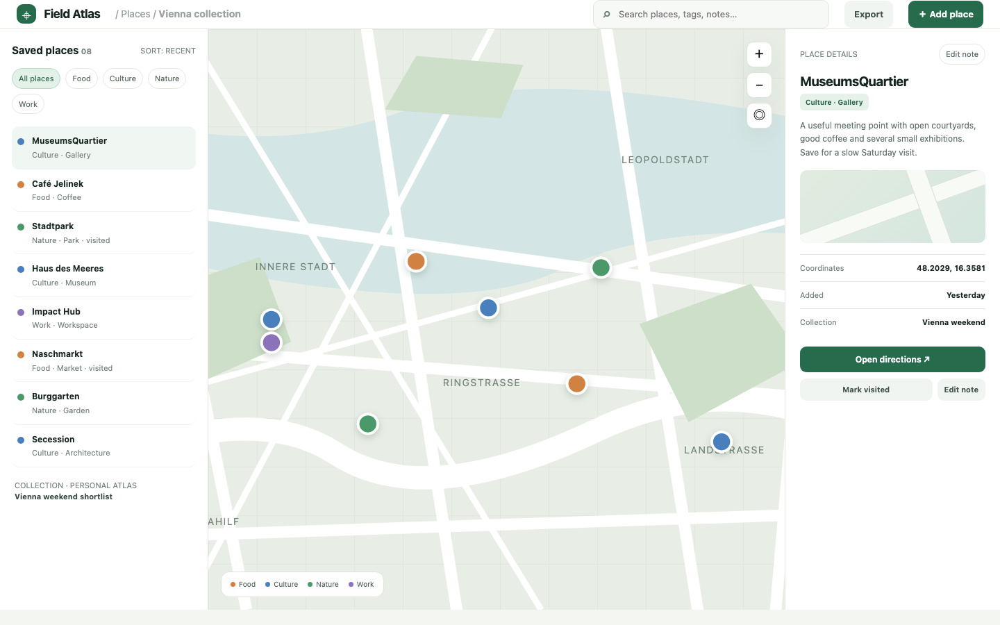

# Places Map

A map-first personal atlas: eight Vienna places across Food, Culture, Nature and Work, category filters, search, an illustrative offline vector map with markers, place details with notes and visit state, collections and a GeoJSON export.

## Run it

```sh
npm install
npm start
```

Open the address it prints (the app keeps its data in `.acryl/`). `npm test` runs the suite; it needs no port and no credentials. Tests pin TZ=UTC and also pass under America/Los_Angeles and Asia/Tokyo.

## What is here

- **Workspace** (`/`): saved places, category chips, search, the vector map with pins and the selected place detail; the map tools are local demo actions.
- **Add place** (`/places/new`): name, category, kind, latitude, longitude, collection and note, with coordinate validation.
- **Edit note** (`/places/:id/edit`): the note editor and the visited action.
- **Collections** (`/collections`): named lists and category totals.
- **Export** (`/export.geojson`): the collection as GeoJSON points.

Every screen is its own Cordis plugin with a row in `blend.yaml` and a `plugin.json`; Settings > Plugins switches any of them off.

## Notes on the design

The seed is the mockup's eight Vienna places with their names, kinds, categories and notes, plus real coordinates and illustrative positions on the local map. The map is an offline SVG so no tile service, key or network is needed; production would use OpenStreetMap tiles with attribution and a pluggable geocoder. The domain is pure, the store, clock and id maker are injected, and each screen is a separate plugin (Clean Architecture's dependency rule, DDD Distilled's place/collection language, A Philosophy of Software Design's module depth).

## What to ask the chat next

- Add a Food place in the second district and show it on the map.
- Filter to Culture, open Secession and edit its note.
- Mark Stadtpark visited and export the GeoJSON.

## Screenshot


